# Frac Treatment Data Engineering | WITS-Style Replay → Databricks

[](https://www.python.org/) [](https://www.databricks.com/) [](https://github.com/Di3g0s/Data_Eng_Frac_Stages_Portfolio/actions/workflows/ci.yml)

**A practical oil & gas data-engineering portfolio project:** replay historical hydraulic-fracturing treatment measurements over a local TCP connection, preserve every received message in a durable journal, publish immutable JSONL batches, and land them in a Databricks Unity Catalog Volume for Bronze ingestion.

The goal is to demonstrate **reproducible ingestion, provenance, delivery verification, recovery, and a clear boundary between source events and processing time**—not to pretend a local replay is live field telemetry.

> **Status:** The local transport, receipt journal, batch export, optional SDK upload loop, synthetic transport tests, and Databricks Bronze notebook template are committed. **Databricks workspace execution, Silver/Gold transformations, orchestration, and BI dashboards are not verified or implemented in this repository.**

## Architecture

```mermaid
flowchart LR
    A[Historical treatment workbook] --> B[Canonical CSV preparation]
    B --> C[WITS-style ASCII replay]
    C -->|Local TCP 127.0.0.1| D[Collector + framing]
    D --> E[(SQLite receipt journal)]
    E --> F[Immutable JSONL export]
    F -->|Databricks SDK / 30 s poll| G[Unity Catalog Volume]
    G -->|Auto Loader template| H[(Bronze Delta)]
    H -. planned .-> I[Silver validation & deduplication]
    I -. planned .-> J[Gold frac-stage KPIs]
```



**This is a WITS Level 0-style *training profile*, not a claim of standards-compliant interoperability with real field equipment.** The project defines its own record-99 channel mapping in [`WITS_starter/wits.py`](WITS_starter/wits.py); the receiver is bound to loopback by design.

## What is implemented?

| Component | Where | Status |
| --- | --- | --- |
| Workbook → canonical CSV adapter | [`data/raw_2_prepared.py`](WITS_starter/data/raw_2_prepared.py) | Implemented; verify source column mapping and time zone |
| Historical message replay | [`replay.py`](WITS_starter/replay.py) | Implemented; preserves original event timestamps |
| TCP framing + receiver | [`wits.py`](WITS_starter/wits.py), [`collector.py`](WITS_starter/collector.py) | Implemented, loopback only |
| Durable receipt journal and repeatable exports | [`journal.py`](WITS_starter/journal.py) | Implemented with SQLite and JSONL |
| Polling upload + remote SHA-256 verification | [`upload_loop.py`](WITS_starter/upload_loop.py) | Implemented; requires Databricks credentials and permissions |
| Databricks Bronze Auto Loader | [`01_ingest_bronze.py`](WITS_starter/01_ingest_bronze.py) | Notebook template; workspace run unverified |
| Silver / Gold / Power BI | — | Future work; intentionally not represented as complete |

## Quick start: local, no Databricks account needed

From the **repository root** (Linux/macOS or GitHub Codespaces):

```bash
python3 -m venv .venv
source .venv/bin/activate
python -m pip install -r requirements.txt
python -m unittest discover -s WITS_starter -p 'test_*.py' -v
```

The existing `WITS_starter/data/prepared/canonical.csv` and both original Excel workbooks are already present in this same repository and are **preserved unchanged** by the upgrade. For new experiments, generate a **separate per-workbook** `stage1.csv` or `stage2.csv`; do not overwrite the legacy CSV. Correcting physical Excel row numbering changes sample IDs, so start a new labelled replay run when migrating. See [data assets and preservation](docs/DATA_ASSETS.md).

The tests use generated synthetic measurements and exercise the TCP sender/collector and restartable journal. They do **not** establish accuracy of any frac interpretation or prove a Databricks deployment.

Run the local receiver from `WITS_starter`:

```bash
cd WITS_starter
python collector.py serve --db spool/receipts.sqlite --port 9000 --run-id demo01
```

From **another terminal**, in `WITS_starter`, prepare **one source workbook per replay**. Example for the included Stage 1 workbook (confirm the source file's use and redistribution rights first):

```bash
python data/raw_2_prepared.py \
  --raw-file 'data/raw/16B(78)-32_Stage 1_Treatment Data.xlsx' \
  --output data/prepared/stage1.csv
python replay.py \
  --csv data/prepared/stage1.csv \
  --original 'data/raw/16B(78)-32_Stage 1_Treatment Data.xlsx' \
  --max-rows 30 --speed 0
python collector.py inspect --db spool/receipts.sqlite
python collector.py export --db spool/receipts.sqlite --out spool/ready
python inspect_received.py
```

`--speed 0` replays as fast as possible. The sender's success message means bytes were **sent**, not that every row was durably received; inspect the journal and reconcile IDs to prove delivery.

## Optional: continuously upload completed batches to Databricks

1. Create a Unity Catalog Volume such as `/Volumes/main/frac_demo/landing` and grant your identity access to its `wits` directory.
2. Configure Databricks authentication in your **Codespace, not in Git**. For your current setup, `frac-demo` is an SDK/CLI profile in `~/.databrickscfg`. For unattended deployments, prefer a service principal with OAuth M2M and Codespaces secrets.
3. In `WITS_starter`, verify a **single** upload cycle, then start the polling loop:

```bash
python upload_loop.py --once --profile frac-demo
python upload_loop.py --profile frac-demo --interval 30
```

The uploader avoids overwrite, downloads the destination, checks its SHA-256, and retries on subsequent cycles after transient failures. It is **not** a managed production service: Codespaces can stop, the local collector is unauthenticated loopback TCP, and the Databricks Bronze notebook still needs workspace validation. The Databricks CLI is a separate optional executable; `databricks-sdk` is the Python library required by the uploader.

See the [data assets](docs/DATA_ASSETS.md), detailed [local runbook](README_WITS.md), [architecture and engineering trade-offs](docs/ARCHITECTURE.md), and [roadmap](docs/ROADMAP.md).

## Dependencies and reproducibility

| Dependency | Used by | Local installation |
| --- | --- | --- |
| Python standard library (`sqlite3`, `socket`, `csv`, etc.) | Sender, collector, journal, tests | Bundled with Python |
| `pandas`, `openpyxl` | Excel-to-CSV preparation | `requirements.txt` |
| `databricks-sdk` | Upload loop | `requirements.txt` |
| PySpark, Delta Lake, Auto Loader | Bronze notebook | Provided by compatible Databricks compute, **not** installed for the local demo |

`requirements.txt` is a **declared direct-dependency set with version ranges**, not a lockfile reproducing every transitive package from a prior Codespace. To record an *actually validated* local environment, run `python -m pip freeze > environment-snapshot.txt` and inspect it before publishing. Do not commit credentials, volumes, receipt databases, or unapproved field data.

## Portfolio talking points

- **Provenance:** source SHA-256, source sheet/row and stable sample IDs survive the replay.
- **Reliability:** raw TCP evidence, parse errors and repeated receipts are journaled; JSONL exports are atomic and replayable.
- **Data modeling:** ingestion time and historical event time are deliberately kept distinct.
- **Honest limitations:** TCP send success is not an application acknowledgment; deduplication belongs in a future Silver layer.

*Author: [Di3g0s](https://github.com/Di3g0s). This repository is a learning/portfolio implementation, not a field-certified data acquisition system.*
